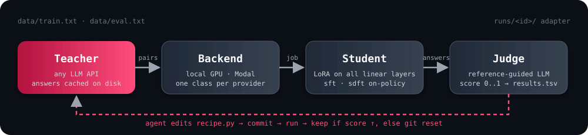

<p align="center">
  
</p>

<h1 align="center">distillery</h1>

<p align="center">
  <em>Pour a big model through an API. Catch a small one.</em>
</p>

<p align="center">
  <a href="#quickstart"></a>
  
  
  
  
</p>

<br>

**distillery** is an [autoresearch](https://github.com/karpathy/autoresearch)-style loop for model distillation.
A teacher behind an API writes the answers, a small open-weights student learns them on a rented (or local) GPU,
an LLM judge scores the student against the teacher, and an agent keeps editing one recipe file until the score stops climbing.

Five classes. One knob file. No training framework.

<p align="center">
  
</p>

## Why

- **Closed models are great teachers, bad servers.** Distill once, run a 0.5B-3B student locally for free.
- **Distillation is mostly a data problem.** The loop treats prompts, teacher instructions and hyperparameters as the search space, not the loss function.
- **Research-backed knobs.** Every field in `recipe.py` maps to a finding in [`RESEARCH.md`](RESEARCH.md): the LoRA learning-rate rule, many epochs on small data, persona-driven prompt synthesis, failure-driven refinement, on-policy self-distillation.

## Quickstart

```bash
git clone <this repo> && cd distillery
uv sync
uv run distill.py --mock --backend local        # offline smoke test, no keys, 135M model, ~1 min
```

**Local everything** (Ollama teacher, Apple GPU or CUDA student):

```bash
export TEACHER_BASE_URL=http://localhost:11434/v1 TEACHER_API_KEY=ollama TEACHER_CONCURRENCY=4
uv run synth.py --task "verbose work emails and docs" --prefix "Rewrite in caveman style: " --n 300
uv run distill.py --backend local --note baseline
```

**Cloud teacher, cloud GPU:**

```bash
export TEACHER_API_KEY=... TEACHER_BASE_URL=https://openrouter.ai/api/v1
uv run modal setup                               # once
DISTILLERY_GPU=H100 uv run distill.py --backend modal --note baseline
```

**Let the agent drive:** open Claude Code (or any coding agent) in the repo and say *"read program.md and start"*.
It edits `recipe.py`, commits, runs, keeps the commit if the score went up and `git reset`s if not. Forever.

## Anatomy

| Piece | File | What it does |
|---|---|---|
| `Teacher` | `distillery/teacher.py` | Calls any OpenAI-compatible chat endpoint. Every answer cached on disk by content hash, so re-runs are free. |
| `Student` | `distillery/student.py` | HF model + LoRA on all linear layers. Two losses: `sft` (copy the teacher's text) and `sdft` (on-policy self-distillation, needs no teacher logits). |
| `Backend` | `distillery/backends.py` | Where the GPU job runs. `LocalBackend`, `ModalBackend`. Adding RunPod or SkyPilot is one small class. |
| `Judge` | `distillery/judge.py` | Reference-guided LLM scoring, 0..1, told to ignore length. `OverlapJudge` for offline runs. |
| `Recipe` | `recipe.py` | Every knob in one dataclass. The only file the agent is allowed to edit. |
| `synth.py` | | Persona-driven prompt generation: the teacher invents who would write such text, then writes it. |
| `program.md` | | The agent's standing orders. |

## What the loop can reach for

Ranked by payoff per effort in a black-box (text-only teacher) setting. Details and citations in [`RESEARCH.md`](RESEARCH.md).

| Tier | Lever | Source |
|---|---|---|
| 0 | LoRA lr ≈ 10x full-FT, small batches, many epochs on small data | LoRA Without Regret · Data Repetition Beats Data Scaling |
| 1 | Diverse synthetic prompts, judge-filtered; short answers and mid-size teachers for small students | Persona Hub · s1 · Small Models Struggle to Learn from Strong Reasoners |
| 2 | Student attempts, teacher rewrites the failures, retrain (`rounds > 1`) | Personalised Distillation · Lion |
| 3 | On-policy: SDFT (`loss = "sdft"`), GAD | Self-Distillation Enables Continual Learning · Black-Box On-Policy Distillation |
| 4 | White-box KD when you host the teacher | GKD · MiniLLM · DistiLLM · Tinker |

## Example: the caveman compressor

Teacher `qwen2.5:7b` (Ollama) rewrites verbose text in caveman style. Student `Qwen2.5-0.5B-Instruct` learns to do it locally.

> **in:** Hi team, I just wanted to quickly follow up on the deployment we discussed yesterday. It looks like the staging environment is still returning a 502 error on the /api/users endpoint, which I believe might be related to the nginx config change that was merged on Tuesday. Could someone from the platform team take a look when they get a chance? Ideally before the 3pm demo. Thanks so much!
>
> **teacher:** Hi team. Quick check on deploy talk yest. Staging still got 502 on /api/users. Think it maybe nginx change Tue. Platform team look when can. Before 3pm demo. Thanks.

97 words in, 30 out, every fact kept.

First run, 93 synthetic training texts, 8 epochs of LoRA on a MacBook GPU, 195 seconds end to end:

| | judge score (0..1) |
|---|---|
| Qwen2.5-0.5B-Instruct, untrained | 0.46 |
| same model after distillery | **0.69** |

> **student, unseen input:** Design team meet today. Talk user journey. Pick key areas. Make pages more relevant. Alloc tasks. Deadlines.

A 0.5B model that does this runs on a laptop at hundreds of tokens per second.

## Roadmap

- [x] Teacher / Student / Judge / Backend classes, Modal backend
- [x] SDFT on-policy loss, failure-refinement rounds, persona prompt synthesis
- [ ] GAD (discriminator-guided on-policy distillation)
- [ ] UI: watch runs, compare recipes, read judge verdicts
- [ ] SDK: `distillery.distill(teacher=..., student=..., prompts=...)` from any Python process

## Teacher terms

Closed APIs (Anthropic, OpenAI, Google) forbid training competing models on their outputs. Default teachers here are open-weights
(Qwen via Ollama or OpenRouter). Check the license of whatever you pour in.

<p align="center"><sub>Built with <a href="RESEARCH.md">20 papers</a> and one wine glass.</sub></p>
